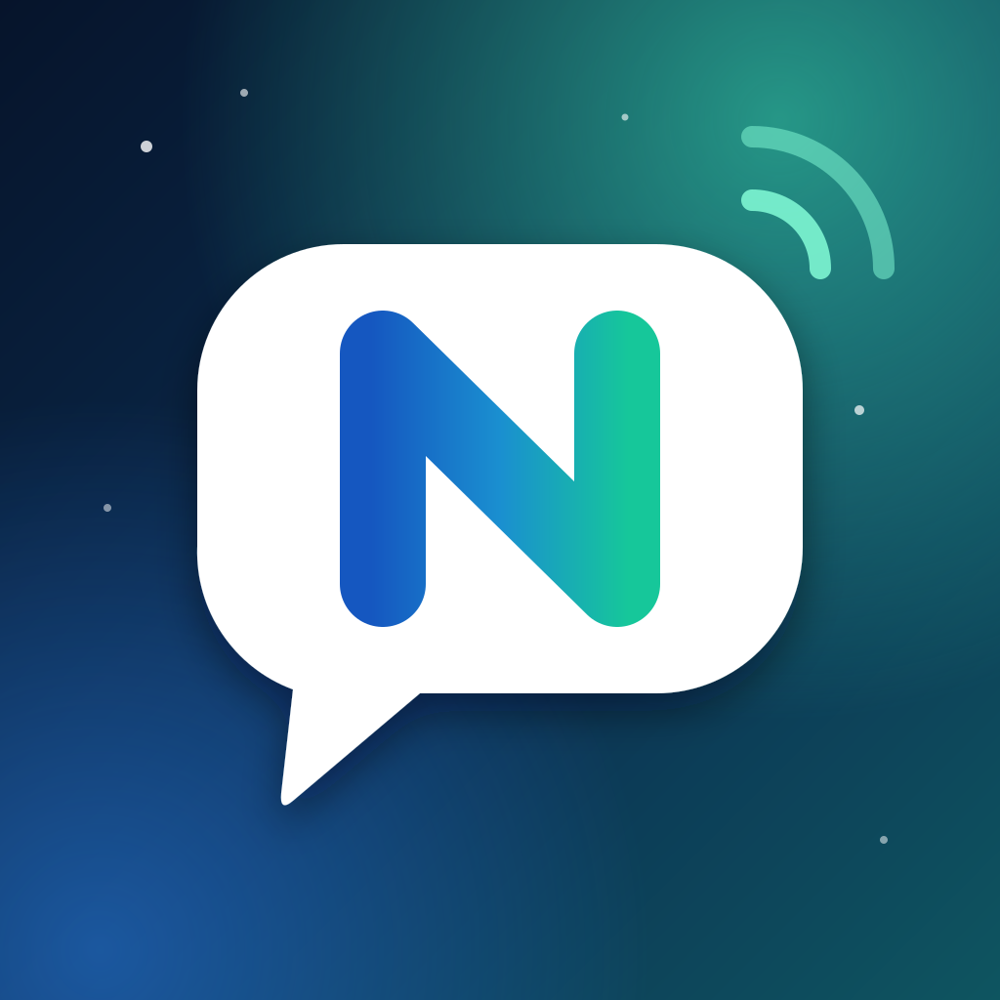

<p align="center">
  
</p>

<h1 align="center">Nordic SMS Tools</h1>

<p align="center">
  Read and send SMS from your 4G router's SIM, with real-time notifications.<br>
  Leggi e invia gli SMS della SIM del tuo router 4G, con notifiche in tempo reale.
</p>

<p align="center">
  <b>ZTE MF286D</b> (Nordic firmware) · <b>ZTE MF297D</b> (TIM firmware)
</p>

<p align="center">
  <a href="#english"><b>🇬🇧 English</b></a> · <a href="#italiano"><b>🇮🇹 Italiano</b></a>
</p>

<p align="center">
  <a href="https://www.youtube.com/watch?v=32fBlYAUUsE">
    
  </a>
  <br>
  <sub>▶ Watch the video on YouTube · Guarda il video su YouTube</sub>
</p>

---

<a id="english"></a>
## 🇬🇧 English

**Menu:** [About](#en-about) · [Features](#en-features) · [Compatibility](#en-compatibility) · [Download](#en-download) · [Notifications](#en-notifications) · [Privacy](#en-privacy) · [Build](#en-build) · [Disclaimer](#en-disclaimer) · [License](#license)

<a id="en-about"></a>
### About

Nordic SMS Tools is a free, open-source Android app that lets you read and send the SMS messages of the SIM card in your 4G router directly from your smartphone, while connected to the router's Wi-Fi network.

No external servers, no accounts: the app talks only to your router, on your local network.

<a id="en-features"></a>
### Features

- 💬 Chat-style conversations, grouped by number, with unread badges
- ↔️ Sender and recipient always shown on every message
- ✉️ Send SMS through the router's SIM, with sending status (🕓 sending, ✓ sent)
- 🔔 WhatsApp-style notifications: contact name, all unread messages, sound, vibration and banner
- ↩️ **Reply** and **Mark as read** directly from the notification, without opening the app
- 🔒 Notifications work with the screen locked and the app closed
- 📇 Built-in contacts: first name, last name, phone number and notes, stored in the app (not on the modem)
- 🗑️ Delete SMS from the router: one message, a whole conversation or all messages at once, checked on the modem
- 🔐 Encrypted credential storage and optional fingerprint unlock
- 🌐 "Use web panel" mode: pauses the app for 10 minutes so you can sign in to the router from your PC
- 🤖 Automatic router detection: the app picks the right login and security method for your model
- 📱 Phone-brand setup guide: extra steps shown only on brands that close background apps (Xiaomi, Samsung, Huawei, OPPO, vivo…)
- 🌍 26 languages, selected automatically from the phone's system language
- 🌙 Light and dark theme, animated splash screen

<a id="en-compatibility"></a>
### Compatibility

| Router | Firmware | Status |
|---|---|---|
| ZTE MF286D | Nordic (Nordic_MF286D_B14) | ✅ Tested |
| ZTE MF297D | TIM (CR_TIMITVPMF297DV1.0.0B04) | ✅ Tested |

> Works only when the phone is connected to the **same network** as the router.

Other ZTE routers with a similar web panel may work but have not been tested. Reports and pull requests are welcome.

<a id="en-download"></a>
### Download

Get the latest APK from the [Releases](https://github.com/ilblogdicristiangallo/Nordic-SMS-Tools/releases) page.

1. Install the APK on your Android phone (allow installation from unknown sources if asked).
2. Open the app, enter the router address and the web panel password.
3. Allow notifications and unrestricted battery usage when prompted.

<a id="en-notifications"></a>
### Notifications setup

On first launch the app asks for:
1. **Notifications** permission.
2. **Unrestricted battery** usage, so SMS arrive even with the screen locked.
3. **Extra steps for your phone brand**, only where needed (Xiaomi, Samsung, Huawei, OPPO, realme, OnePlus, vivo…). Motorola, Google Pixel, Nokia and Sony need no extra steps.

New SMS are checked every 15 seconds while the phone is on the router's Wi-Fi.

<a id="en-privacy"></a>
### Privacy

- The app communicates only with your router on the local network.
- The router password is stored encrypted on the device.
- The app does not use your phone's SIM and needs no SMS permissions.
- Contacts are stored only inside the app.

<a id="en-build"></a>
### Build from source

```bash
flutter pub get
flutter build apk --release
```

<a id="en-disclaimer"></a>
### Disclaimer

Nordic SMS Tools is an independent app, not affiliated with or endorsed by ZTE Corporation or TIM.
"ZTE", "MF286D", "MF297D" and "TIM" are trademarks of their respective owners and are mentioned only to indicate compatibility.

<p align="right"><a href="#english">↑ Back to top</a></p>

---

<a id="italiano"></a>
## 🇮🇹 Italiano

**Menu:** [Cos'è](#it-about) · [Funzioni](#it-features) · [Compatibilità](#it-compatibility) · [Download](#it-download) · [Notifiche](#it-notifications) · [Privacy](#it-privacy) · [Compilazione](#it-build) · [Avvertenze](#it-disclaimer) · [Licenza](#license)

<a id="it-about"></a>
### Cos'è

Nordic SMS Tools è un'app Android gratuita e open source che ti permette di leggere e inviare gli SMS della SIM inserita nel tuo router 4G direttamente dallo smartphone, quando sei connesso alla rete Wi-Fi del router.

Nessun server esterno, nessun account: l'app comunica solo con il tuo router, sulla tua rete locale.

<a id="it-features"></a>
### Funzioni

- 💬 Conversazioni in stile chat, raggruppate per numero, con indicatore dei non letti
- ↔️ Mittente e destinatario sempre visibili su ogni messaggio
- ✉️ Invio SMS tramite la SIM del router, con stato dell'invio (🕓 in invio, ✓ inviato)
- 🔔 Notifiche stile WhatsApp: nome del contatto, tutti i messaggi non letti, suono, vibrazione e banner
- ↩️ **Rispondi** e **Segna come letto** direttamente dalla notifica, senza aprire l'app
- 🔒 Le notifiche arrivano anche a schermo bloccato e con l'app chiusa
- 📇 Rubrica integrata: nome, cognome, numero e note, salvati nell'app (non sul modem)
- 🗑️ Eliminazione degli SMS dal router: un messaggio, un'intera conversazione o tutti insieme, con verifica sul modem
- 🔐 Credenziali salvate cifrate e sblocco opzionale con impronta digitale
- 🌐 Modalità "Usa il pannello web": l'app si mette in pausa per 10 minuti per farti accedere al router dal PC
- 🤖 Riconoscimento automatico del router: l'app sceglie da sola il metodo di accesso e sicurezza giusto per il tuo modello
- 📱 Guida per marca di telefono: passaggi extra mostrati solo sulle marche che chiudono le app in background (Xiaomi, Samsung, Huawei, OPPO, vivo…)
- 🌍 26 lingue, scelte in automatico dalla lingua del telefono
- 🌙 Tema chiaro e scuro, splash screen animata

<a id="it-compatibility"></a>
### Compatibilità

| Router | Firmware | Stato |
|---|---|---|
| ZTE MF286D | Nordic (Nordic_MF286D_B14) | ✅ Testato |
| ZTE MF297D | TIM (CR_TIMITVPMF297DV1.0.0B04) | ✅ Testato |

> Funziona solo quando il telefono è collegato alla **stessa rete** del router.

Altri router ZTE con un pannello web simile potrebbero funzionare, ma non sono stati provati. Segnalazioni e pull request sono benvenute.

<a id="it-download"></a>
### Download

Scarica l'ultimo APK dalla pagina [Releases](https://github.com/ilblogdicristiangallo/Nordic-SMS-Tools/releases).

1. Installa l'APK sul telefono Android (se richiesto, consenti l'installazione da origini sconosciute).
2. Apri l'app, inserisci l'indirizzo del router e la password del pannello web.
3. Consenti le notifiche e l'uso della batteria senza restrizioni quando l'app li chiede.

<a id="it-notifications"></a>
### Configurazione delle notifiche

Al primo avvio l'app chiede:
1. Il permesso per le **notifiche**.
2. L'uso della **batteria senza restrizioni**, così gli SMS arrivano anche a schermo bloccato.
3. I **passaggi extra per la marca del telefono**, solo dove servono (Xiaomi, Samsung, Huawei, OPPO, realme, OnePlus, vivo…). Motorola, Google Pixel, Nokia e Sony non hanno bisogno di passaggi extra.

I nuovi SMS vengono controllati ogni 15 secondi, quando il telefono è collegato al Wi-Fi del router.

<a id="it-privacy"></a>
### Privacy

- L'app comunica solo con il tuo router, sulla rete locale.
- La password del router è salvata cifrata sul dispositivo.
- L'app non usa la SIM del telefono e non richiede permessi SMS.
- I contatti sono salvati solo all'interno dell'app.

<a id="it-build"></a>
### Compilazione dal codice sorgente

```bash
flutter pub get
flutter build apk --release
```

<a id="it-disclaimer"></a>
### Avvertenze

Nordic SMS Tools è un'app indipendente, non affiliata né approvata da ZTE Corporation o da TIM.
"ZTE", "MF286D", "MF297D" e "TIM" sono marchi dei rispettivi proprietari, citati solo per indicare la compatibilità.

<p align="right"><a href="#italiano">↑ Torna su</a></p>

---

<a id="license"></a>
## License / Licenza

[MIT](LICENSE) · © 2026 Cristian Gallo
